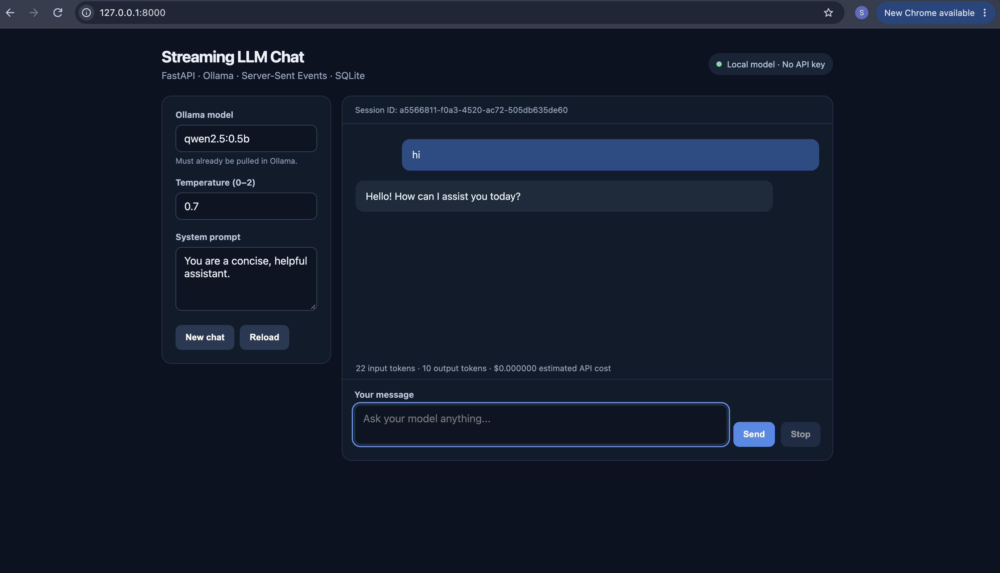
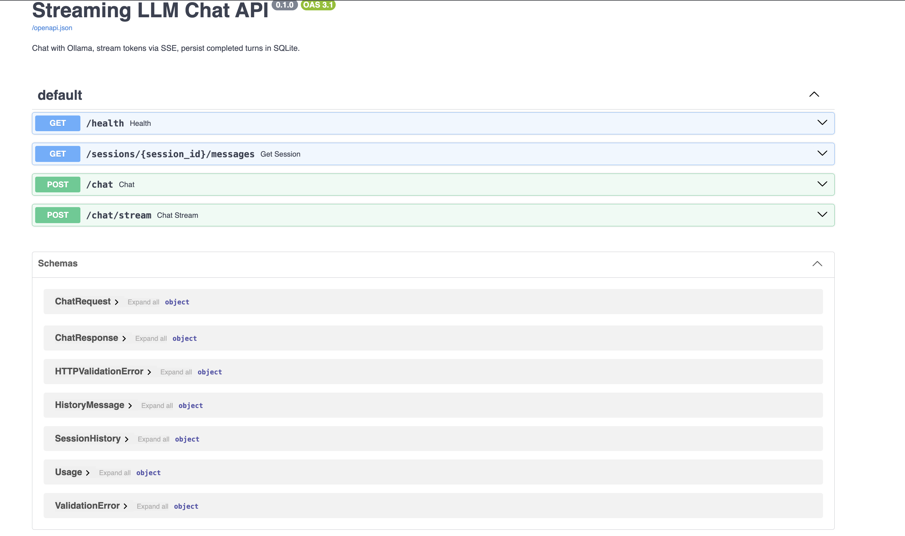
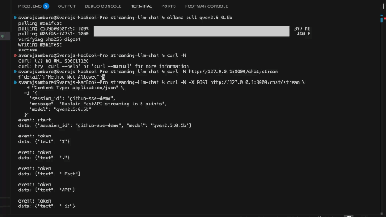
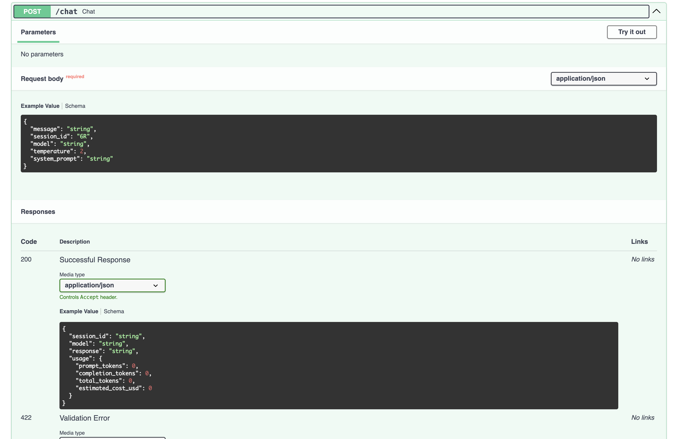
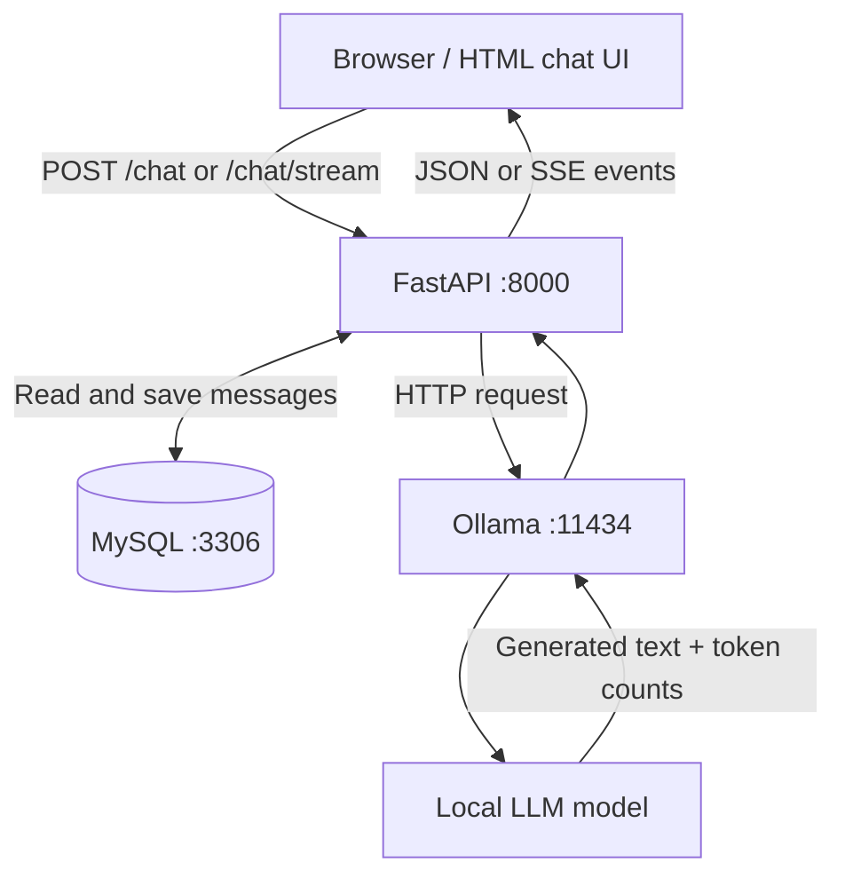

# Streaming LLM Chat API

**FastAPI + Ollama + MySQL + Server-Sent Events (SSE) + uv**

A simple AI chatbot that runs a language model locally, streams answers as they are generated, and saves conversation history in MySQL. The local Ollama model does **not** need an OpenAI or other cloud LLM API key.

## Screenshots and demo

### 1. Chat interface

Ask questions, change model settings, and view AI replies.



### 2. FastAPI endpoints

Open the automatically generated API documentation at `http://127.0.0.1:8000/docs`.



### 3. SSE streaming (animated GIF)

The `/chat/stream` endpoint sends response fragments as soon as Ollama produces them.



### 4. Token usage and estimated cost

See input tokens, output tokens, and estimated cloud API cost.



## What does this project do?

- **`POST /chat`** returns one complete JSON answer.
- **`POST /chat/stream`** streams the answer using Server-Sent Events (SSE).
- Supports a configurable **model**, **temperature**, and **system prompt**.
- Saves conversation history using a **`session_id`** in **MySQL**.
- Returns prompt tokens, completion tokens, and estimated API cost.
- Handles provider timeouts and errors, with limited retries.
- Provides a lightweight HTML + JavaScript chatbot.
- Uses uv to manage Python packages and the development environment.

## Technologies explained simply

| Technology          | What it does                                             |
| ------------------- | -------------------------------------------------------- |
| Python              | Language used to write the backend                       |
| FastAPI             | Receives HTTP requests and defines API endpoints         |
| Uvicorn             | Runs the FastAPI server                                  |
| Ollama              | Runs the downloaded LLM on your computer                 |
| `qwen2.5:0.5b`      | Example lightweight language model                       |
| HTTPX               | Makes HTTP requests from FastAPI to Ollama               |
| MySQL               | Stores conversation messages and history                 |
| MySQL Python driver | Allows Python to communicate with MySQL                  |
| Pydantic Settings   | Reads configuration from `.env`                          |
| HTML + JavaScript   | Creates the chat interface and displays streaming output |
| uv                  | Creates Python environments and installs packages        |
| pytest              | Runs automated tests                                     |

## Architecture



### How a message flows through the application

1. The user enters a question in the browser.
2. JavaScript sends the message and `session_id` to FastAPI.
3. FastAPI validates the request and retrieves earlier messages for that session from MySQL.
4. FastAPI sends the system prompt, conversation history, and new message to Ollama.
5. Ollama runs the locally downloaded LLM and generates an answer.
6. For `/chat`, FastAPI waits and returns one complete JSON response. For `/chat/stream`, it sends text fragments as SSE events.
7. When generation succeeds, the completed exchange and token usage are stored in MySQL.
8. Reusing the same `session_id` allows the next question to include the previous conversation.

## Why no API key is required

Ollama downloads the language model's weights onto your computer.

FastAPI sends requests to the local Ollama server:

```text
http://127.0.0.1:11434/api/chat
```

Because this is a local API, it does not require a cloud LLM API key.

You need internet access to download the model initially, but local inference can run offline afterward. Inference still uses your CPU/GPU, memory, and electricity.

**MySQL credentials are different:** MySQL can require a database username and password even though the local language model does not require an API key.

## Project structure and file purposes

This structure follows the earlier FastAPI POC. Check your actual MySQL storage module filename.

```text
streaming-llm-chat/
├── README.md
├── requirements.txt
├── pyproject.toml
├── uv.lock
├── .env.example
├── .env
├── .gitignore
├── app/
│   ├── __init__.py
│   ├── main.py
│   ├── config.py
│   ├── schemas.py
│   ├── ollama.py
│   ├── mysql_storage.py
│   └── static/
│       └── index.html
├── tests/
└── screenshots/
        ├── chat_interface.png
        ├── endpoints.png
        ├── streaming_sse.gif
        └── token_usage.png
```

`mysql_storage.py` is an example filename. Your implementation might use `database.py`, `storage.py`, or another name.

| File                    | Explanation                                                                          |
| ----------------------- | ------------------------------------------------------------------------------------ |
| `app/main.py`           | Defines the FastAPI routes, controls requests, and returns API responses.            |
| `app/config.py`         | Loads model, Ollama address, timeouts, and database settings.                        |
| `app/schemas.py`        | Validates request and response data using Pydantic.                                  |
| `app/ollama.py`         | Calls Ollama and manages generated chunks, retries, timeouts, and errors.            |
| MySQL storage module    | Connects to MySQL, reads conversation history, and saves completed chats.            |
| `app/static/index.html` | Contains the browser interface, CSS, and JavaScript streaming logic.                 |
| `requirements.txt`      | Lists Python libraries required by the project.                                      |
| `pyproject.toml`        | Stores project metadata and dependencies for uv.                                     |
| `uv.lock`               | Records resolved dependency versions.                                                |
| `.env`                  | Stores local configuration and database credentials. Never push this file to GitHub. |
| `.env.example`          | Provides a safe configuration template.                                              |
| `.gitignore`            | Prevents secrets, virtual environments, and temporary files from being committed.    |
| `tests/`                | Contains automated tests for the API and provider behavior.                          |

## Installation and running — step by step

### Step 1 — Install the required software

Install Python 3.12, uv, MySQL Server, and Ollama.

- uv: https://docs.astral.sh/uv/getting-started/installation/
- MySQL: https://dev.mysql.com/downloads/mysql/
- Ollama: https://ollama.com/download

**Windows PowerShell:**

```powershell
powershell -ExecutionPolicy Bypass -c "irm https://astral.sh/uv/install.ps1 | iex"
uv --version
```

**macOS / Linux:**

```bash
curl -LsSf https://astral.sh/uv/install.sh | sh
uv --version
```

### Step 2 — Open the project directory

```bash
cd streaming-llm-chat
```

Run commands from the folder containing `app/` and `requirements.txt`.

### Step 3 — Install Python dependencies

**Option A: If your project uses `pyproject.toml` (recommended for uv)**

Ensure that its dependencies match the MySQL driver imported by your working application.

```bash
uv python install 3.12
uv sync --python 3.12
```

For example, if the project uses `import aiomysql`, you can add it to uv using:

```bash
uv add aiomysql
```

If your project still lists a PostgreSQL driver, update the dependencies to match your MySQL implementation.

**Option B: If your project uses only `requirements.txt`**

```bash
uv python install 3.12
uv venv --python 3.12
uv pip install -r requirements.txt
```

Activate the virtual environment.

Windows PowerShell:

```powershell
.venv\Scripts\Activate.ps1
```

macOS / Linux:

```bash
source .venv/bin/activate
```

The example `requirements.txt` uses `aiomysql`. If your source code imports `mysql.connector`, `pymysql`, or another driver, install the matching dependency instead.

### Step 4 — Start MySQL and prepare the database

Make sure MySQL Server is running.

Open MySQL Workbench or the MySQL command-line client.

If you need a new local database, execute:

```sql
CREATE DATABASE IF NOT EXISTS llm_chat
  CHARACTER SET utf8mb4 COLLATE utf8mb4_unicode_ci;

CREATE USER IF NOT EXISTS 'chat_user'@'127.0.0.1'
  IDENTIFIED BY 'CHANGE_THIS_TO_A_STRONG_PASSWORD';

GRANT ALL PRIVILEGES ON llm_chat.*
  TO 'chat_user'@'127.0.0.1';
```

Replace the sample password with a secure password.

If your application already works, keep its current database, credentials, and schema rather than creating another database.

The database creation commands above do not automatically create your chat tables. Your Python storage code or database migrations must create those tables.

### Step 5 — Download and test the local Ollama model

```bash
ollama pull qwen2.5:0.5b
ollama list
ollama run qwen2.5:0.5b
```

Ask a simple question and verify the model responds.

If Ollama is not already running, start it in another terminal:

```bash
ollama serve
```

You can check the local Ollama API using:

```bash
curl http://127.0.0.1:11434/api/tags
```

### Step 6 — Configure `.env`

Copy the template if your project contains one:

```bash
cp .env.example .env
```

For Windows PowerShell:

```powershell
Copy-Item .env.example .env
```

Example Ollama configuration:

```dotenv
OLLAMA_BASE_URL=http://127.0.0.1:11434
DEFAULT_MODEL=qwen2.5:0.5b
DEFAULT_TEMPERATURE=0.7
DEFAULT_SYSTEM_PROMPT=You are a helpful assistant.
INPUT_COST_PER_MILLION_USD=0
OUTPUT_COST_PER_MILLION_USD=0
```

Example MySQL settings:

```dotenv
MYSQL_HOST=127.0.0.1
MYSQL_PORT=3306
MYSQL_USER=chat_user
MYSQL_PASSWORD=CHANGE_THIS_TO_A_STRONG_PASSWORD
MYSQL_DATABASE=llm_chat
```

Use the MySQL configuration variable names that your `app/config.py` actually supports.

Some applications use one `DATABASE_URL` instead of separate `MYSQL_*` settings. For example, SQLAlchemy with aiomysql may use a `mysql+aiomysql://...` URL. These approaches require corresponding Python code and are not interchangeable simply by editing `.env`.

### Step 7 — Start the FastAPI application

If dependencies were installed using `uv sync`:

```bash
uv run uvicorn app.main:app --reload --host 127.0.0.1 --port 8000
```

If you installed with `uv pip install -r requirements.txt` and activated `.venv`:

```bash
uvicorn app.main:app --reload --host 127.0.0.1 --port 8000
```

`app.main:app` tells Uvicorn to find the FastAPI application named `app` inside `app/main.py`.

`--reload` restarts the development server when files change.

### Step 8 — Open and test the application

| Page         | URL                          |
| ------------ | ---------------------------- |
| Chat UI      | http://127.0.0.1:8000/       |
| Swagger UI   | http://127.0.0.1:8000/docs   |
| ReDoc        | http://127.0.0.1:8000/redoc  |
| Health check | http://127.0.0.1:8000/health |

Enter a question in the chat interface and verify that the response appears progressively.

## API endpoints and how to demonstrate them

These routes follow the earlier FastAPI POC. Use `/docs` and your current `app/main.py` to confirm the routes in your MySQL version.

| Method | Route                             | Purpose                                        |
| ------ | --------------------------------- | ---------------------------------------------- |
| GET    | `/`                               | Opens the browser chat interface               |
| GET    | `/health`                         | Returns API status and default model           |
| GET    | `/config`                         | Returns public default settings                |
| POST   | `/chat`                           | Returns a complete AI answer and usage as JSON |
| POST   | `/chat/stream`                    | Streams text as Server-Sent Events             |
| GET    | `/sessions/{session_id}/messages` | Retrieves messages saved for a session         |
| GET    | `/docs`                           | Displays Swagger UI                            |
| GET    | `/redoc`                          | Displays alternative API documentation         |
| GET    | `/openapi.json`                   | Returns the OpenAPI specification              |

`/` and `/config` may be intentionally hidden from the Swagger endpoint list.

### Demo A — Full response: `POST /chat`

Open `/docs`.

Expand **POST /chat**, click **Try it out**, and paste:

```json
{
  "session_id": "github-demo-01",
  "message": "Explain FastAPI in three simple points.",
  "model": "qwen2.5:0.5b",
  "temperature": 0.7,
  "system_prompt": "Explain things in simple English."
}
```

Click **Execute**.

The API waits for Ollama to finish generating and returns one JSON response containing the answer, session ID, model, and usage data.

### Demo B — Streaming: `POST /chat/stream`

For macOS / Linux / Git Bash, open a second terminal:

```bash
curl -N -X POST http://127.0.0.1:8000/chat/stream \
  -H "Content-Type: application/json" \
  -d '{"session_id":"github-sse-demo","message":"Explain SSE in five points","model":"qwen2.5:0.5b"}'
```

For Windows PowerShell:

```powershell
'{"session_id":"github-sse-demo","message":"Explain SSE in five points","model":"qwen2.5:0.5b"}' | Set-Content -Encoding ascii demo.json

curl.exe -N -X POST http://127.0.0.1:8000/chat/stream -H "Content-Type: application/json" --data-binary "@demo.json"
```

Example output :

```text
curl -N -X POST http://127.0.0.1:8000/chat/stream \
  -H "Content-Type: application/json" \
  -d '{
    "session_id": "github-sse-demo",
    "message": "Explain FastAPI streaming in 5 points",
    "model": "qwen2.5:0.5b"
  }'
event: start
data: {"session_id": "github-sse-demo", "model": "qwen2.5:0.5b"}

event: token
data: {"text": "1"}

event: token
data: {"text": "."}

event: token
data: {"text": " Fast"}

event: token
data: {"text": "API"}

event: token
data: {"text": " is"}

event: token
data: {"text": " a"}

event: token
data: {"text": " modern"}

event: token
data: {"text": ","}

event: token
data: {"text": " web"}

event: token
data: {"text": " framework"}

event: token
data: {"text": " for"}

event: token
data: {"text": " building"}

event: token
data: {"text": " APIs"}

event: token
data: {"text": " that"}

event: token
data: {"text": " can"}

event: token
data: {"text": " be"}

event: token
data: {"text": " both"}

event: token
data: {"text": " fast"}

event: token
data: {"text": " and"}

event: token
data: {"text": " scalable"}

event: token
data: {"text": ".\n"}

event: token
data: {"text": " "}

event: token
data: {"text": " "}

event: token
data: {"text": "2"}

event: token
data: {"text": "."}

event: token
data: {"text": " Streaming"}

event: token
data: {"text": " is"}

event: token
data: {"text": " a"}

event: token
data: {"text": " feature"}

event: token
data: {"text": " of"}

event: token
data: {"text": " Fast"}

event: token
data: {"text": "API"}

event: token
data: {"text": " that"}

event: token
data: {"text": " allows"}

event: token
data: {"text": " for"}

event: token
data: {"text": " the"}

event: token
data: {"text": " processing"}

event: token
data: {"text": " of"}

event: token
data: {"text": " data"}

event: token
data: {"text": " in"}

event: token
data: {"text": " chunks"}

event: token
data: {"text": ","}

event: token
data: {"text": " rather"}

event: token
data: {"text": " than"}

event: token
data: {"text": " all"}

event: token
data: {"text": " at"}

event: token
data: {"text": " once"}

event: token
data: {"text": ".\n"}

event: token
data: {"text": " "}

event: token
data: {"text": " "}

event: token
data: {"text": "3"}

event: token
data: {"text": "."}

event: token
data: {"text": " Fast"}

event: token
data: {"text": "API"}

event: token
data: {"text": "'s"}

event: token
data: {"text": " built"}

event: token
data: {"text": "-in"}

event: token
data: {"text": " asynchronous"}

event: token
data: {"text": " processing"}

event: token
data: {"text": " means"}

event: token
data: {"text": " that"}

event: token
data: {"text": " data"}

event: token
data: {"text": " can"}

event: token
data: {"text": " be"}

event: token
data: {"text": " streamed"}

event: token
data: {"text": " in"}

event: token
data: {"text": " parallel"}

event: token
data: {"text": ","}

event: token
data: {"text": " which"}

event: token
data: {"text": " can"}

event: token
data: {"text": " improve"}

event: token
data: {"text": " performance"}

event: token
data: {"text": ".\n"}

event: token
data: {"text": " "}

event: token
data: {"text": " "}

event: token
data: {"text": "4"}

event: token
data: {"text": "."}

event: token
data: {"text": " Fast"}

event: token
data: {"text": "API"}

event: token
data: {"text": "'s"}

event: token
data: {"text": " use"}

event: token
data: {"text": " of"}

event: token
data: {"text": " async"}

event: token
data: {"text": " functions"}

event: token
data: {"text": " can"}

event: token
data: {"text": " be"}

event: token
data: {"text": " used"}

event: token
data: {"text": " to"}

event: token
data: {"text": " write"}

event: token
data: {"text": " streaming"}

event: token
data: {"text": " APIs"}

event: token
data: {"text": " that"}

event: token
data: {"text": " handle"}

event: token
data: {"text": " large"}

event: token
data: {"text": " amounts"}

event: token
data: {"text": " of"}

event: token
data: {"text": " data"}

event: token
data: {"text": " efficiently"}

event: token
data: {"text": ".\n"}

event: token
data: {"text": " "}

event: token
data: {"text": " "}

event: token
data: {"text": "5"}

event: token
data: {"text": "."}

event: token
data: {"text": " Fast"}

event: token
data: {"text": "API"}

event: token
data: {"text": "'s"}

event: token
data: {"text": " use"}

event: token
data: {"text": " of"}

event: token
data: {"text": " the"}

event: token
data: {"text": " \""}

event: token
data: {"text": "use"}

event: token
data: {"text": "gger"}

event: token
data: {"text": "\""}

event: token
data: {"text": " pattern"}

event: token
data: {"text": " can"}

event: token
data: {"text": " be"}

event: token
data: {"text": " used"}

event: token
data: {"text": " to"}

event: token
data: {"text": " write"}

event: token
data: {"text": " streaming"}

event: token
data: {"text": " APIs"}

event: token
data: {"text": " that"}

event: token
data: {"text": " handle"}

event: token
data: {"text": " large"}

event: token
data: {"text": " amounts"}

event: token
data: {"text": " of"}

event: token
data: {"text": " data"}

event: token
data: {"text": " efficiently"}

event: token
data: {"text": "."}

event: done
data: {"session_id": "github-sse-demo", "model": "qwen2.5:0.5b", "usage": {"prompt_tokens": 30, "completion_tokens": 130, "total_token
s": 160, "estimated_cost_usd": 0.0}}

```

The main SSE event types are:

- `start`: Streaming has begun.
- `token`: A new text fragment has arrived. A fragment is not necessarily exactly one model token.
- `done`: Generation has finished and usage is available.
- `error`: Something failed during generation or storage.

**Why use `curl -N`?**

It disables output buffering so you can see events arriving live.

The HTML interface uses JavaScript `fetch()` to read the stream, because `/chat/stream` accepts a POST request with JSON.


## MySQL conversation memory

MySQL stores the conversation data, not the AI model itself.

A common design uses a `messages` table for user/assistant messages and a `turns` table for token usage and model information.

Your MySQL schema might use different table names.

To inspect your database in MySQL Workbench:

```sql
USE llm_chat;
SHOW TABLES;
```

If your application has a `messages` table:

```sql
SELECT * FROM messages LIMIT 10;
```

If your application has a `turns` table:

```sql
SELECT * FROM turns LIMIT 10;
```

Use your existing database name and table names.

## Token usage and estimated cost

Ollama provides usage information such as `prompt_eval_count` and `eval_count`.

```text
prompt_tokens     = tokens used to process input
completion_tokens = tokens generated as output
total_tokens      = prompt_tokens + completion_tokens
```

A typical estimated API cost calculation is:

```text
cost_usd = (prompt_tokens / 1,000,000 × input_price_per_million)
         + (completion_tokens / 1,000,000 × output_price_per_million)
```

If the local Ollama model has both API price rates configured as zero, the estimated cloud API cost is `$0`.

## Timeouts, retries, and error handling

- **Connection timeout:** Avoid waiting forever when Ollama cannot be reached.
- **Read timeout:** Stop requests that become unresponsive.
- **Retries:** Retry some temporary provider errors, ideally before any text has been streamed.
- **Structured errors:** Return readable messages instead of Python tracebacks.
- **Safe persistence:** Avoid saving an incomplete generation as a successful assistant response.

## Common problems

| Problem                    | Solution                                                 |
| -------------------------- | -------------------------------------------------------- |
| Model not found            | Run `ollama list` and download the selected model.       |
| Ollama connection refused  | Verify Ollama is running and the base URL is correct.    |
| MySQL access denied        | Check username, password, host, and permissions.         |
| MySQL connection refused   | Verify MySQL Server is running on the configured port.   |
| MySQL table does not exist | Inspect your actual database schema.                     |
| `uv` not found             | Restart the terminal or check your PATH.                 |
| No streamed text           | Check FastAPI logs, Ollama logs, and the selected model. |
| Dependency errors          | Check which MySQL driver your Python code imports.       |

## Helpful documentation

- [FastAPI](https://fastapi.tiangolo.com/)
- [Ollama](https://docs.ollama.com/)
- [MySQL](https://dev.mysql.com/doc/)
- [uv](https://docs.astral.sh/uv/)

---

**Learning POC:** FastAPI, locally hosted LLM inference, Server-Sent Events streaming, MySQL session storage, API reliability, and uv package management.
